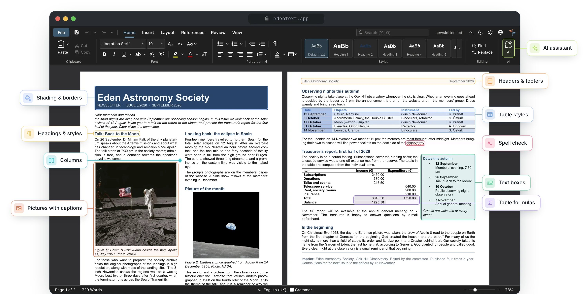
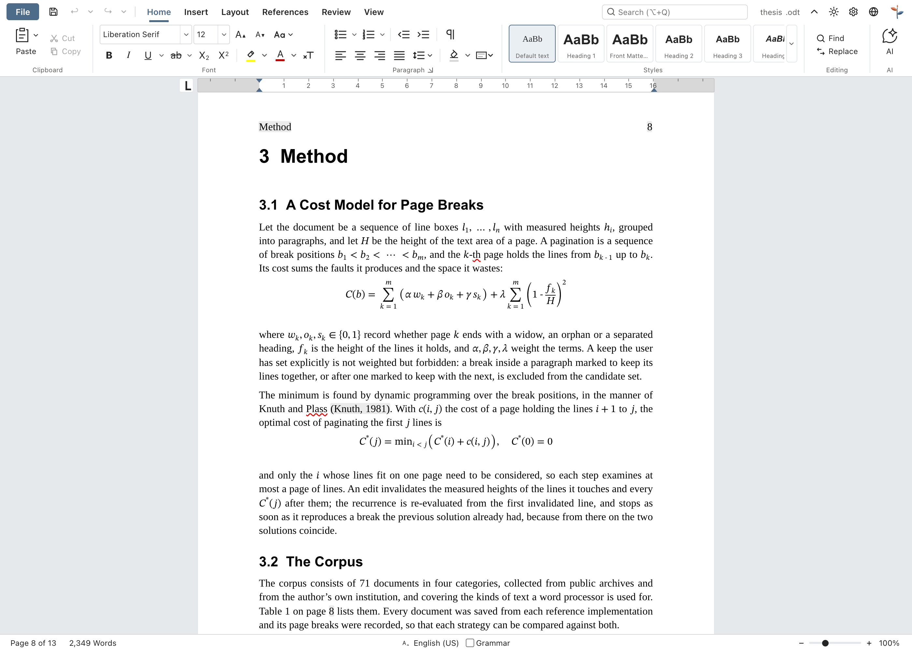
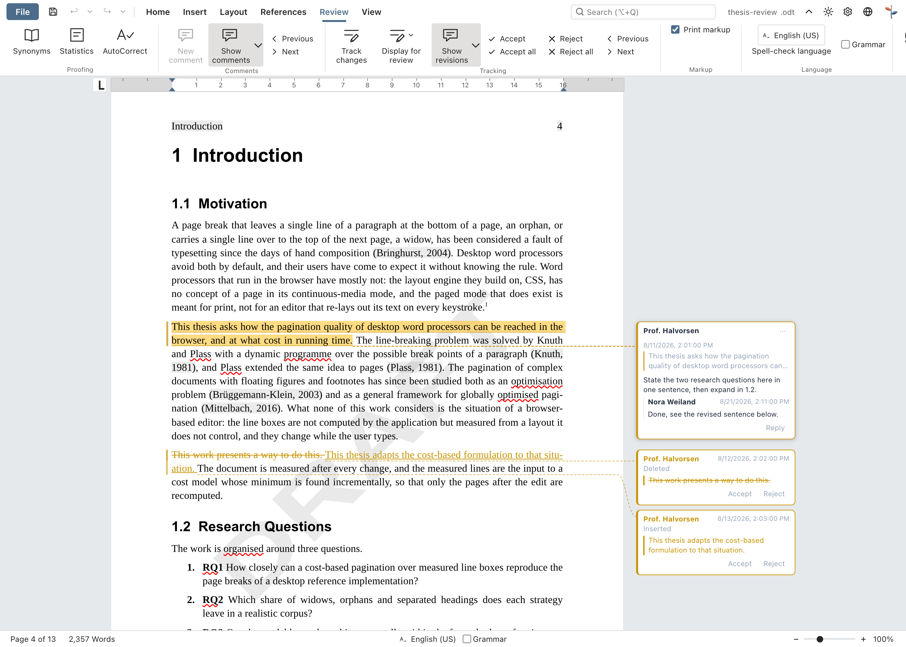
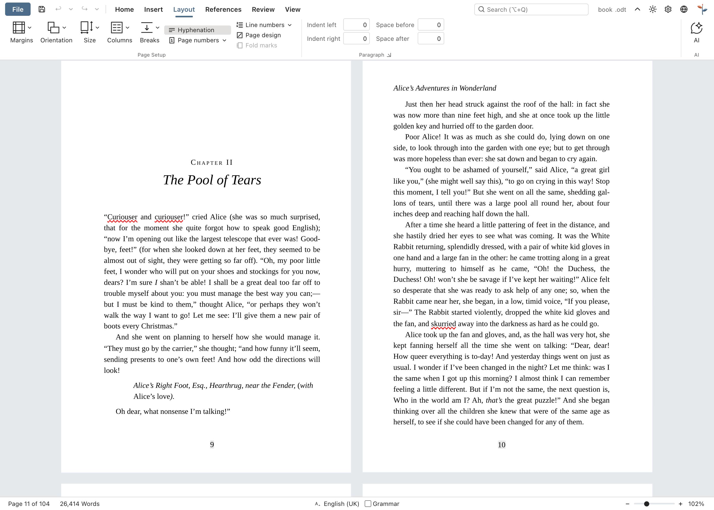
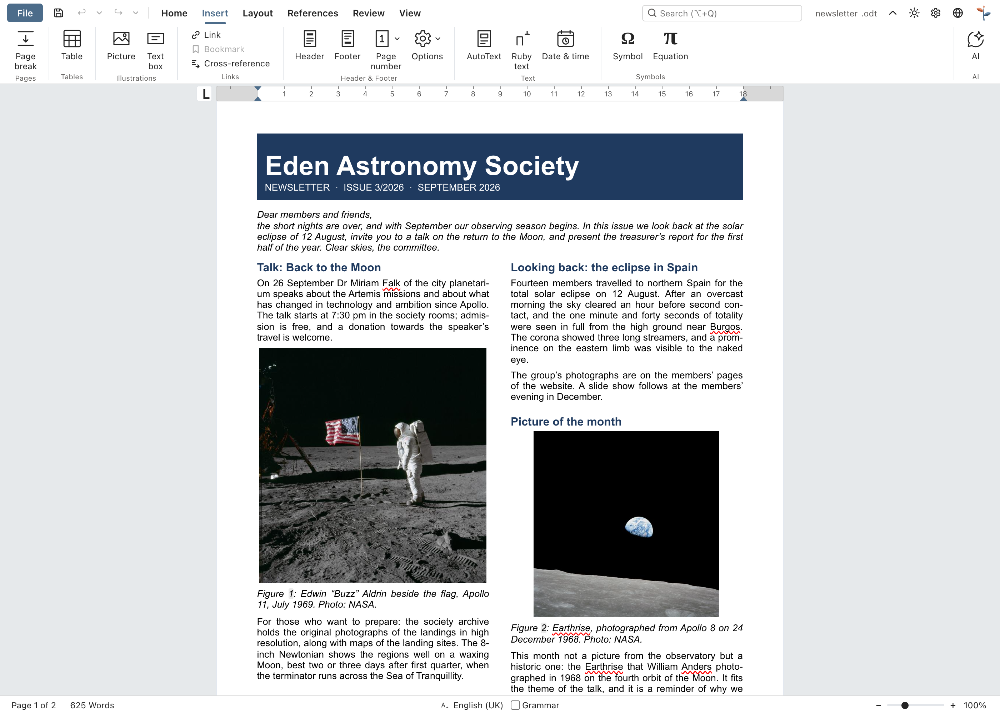
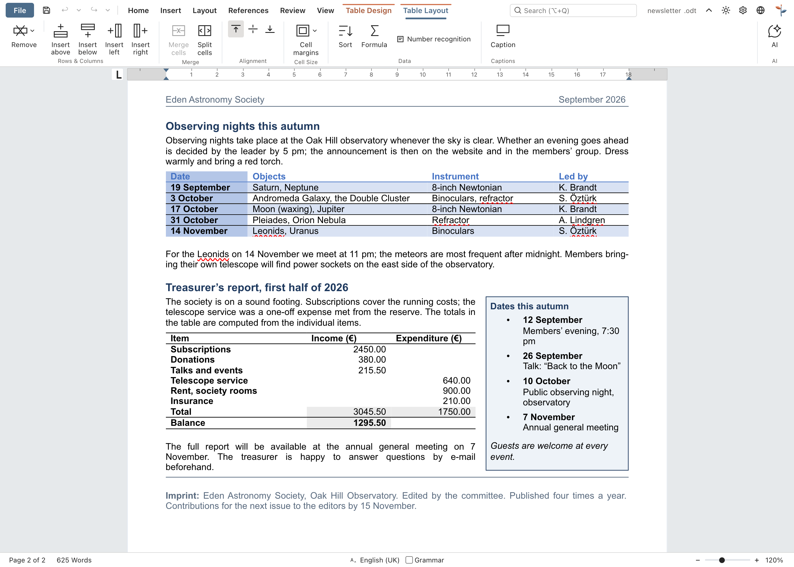
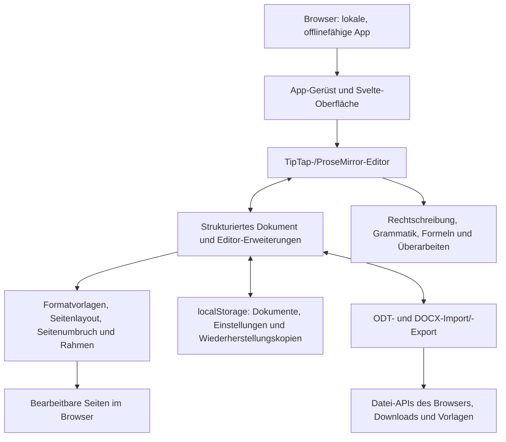

<p align="center">
  
</p>

<h1 align="center">
  
</h1>

<p align="center">
  <strong>Vollwertige Textverarbeitung direkt im Browser</strong><br>
  Kostenlos · Open Source · Private by Design
</p>

<p align="center">
  <a href="https://github.com/stffnb/edentext/actions/workflows/ci.yml"></a>
  <a href="LICENSE"></a>
  <a href="CHANGELOG.md"></a>
  
</p>

<p align="center">
  <a href="https://edentext.app"><strong>▶ EdenText öffnen</strong></a>
</p>

<p align="center">
  <a href="README.md">English</a> · <b>Deutsch</b> · <a href="README.es.md">Español</a> · <a href="README.fr.md">Français</a> · <a href="README.pt.md">Português</a> · <a href="README.el.md">Ελληνικά</a> · <a href="README.ru.md">Русский</a> · <a href="README.uk.md">Українська</a> · <a href="README.ja.md">日本語</a> · <a href="README.zh-CN.md">简体中文</a> · <a href="README.zh-TW.md">繁體中文</a>
</p>

<picture>
  <source media="(prefers-color-scheme: dark)" srcset="docs/hero-dark.webp">
  
</picture>

---

EdenText ist eine leistungsstarke Textverarbeitung im Browser – für alles von der schnellen Notiz bis zum ganzen Buch. Kein Server, kein Konto: Alles wird lokal verarbeitet, die Dokumente verlassen nie den eigenen Rechner. Einfach den Link öffnen oder EdenText als App installieren und offline nutzen. Der erste Download ist für die meisten Sprachen etwa 2 MB groß, Wörterbücher und Schriften werden erst bei Bedarf geladen[^1]. Die Oberfläche gibt es auf Englisch, Deutsch, Spanisch, Französisch, Portugiesisch, Griechisch, Russisch, Ukrainisch, Japanisch und Chinesisch (vereinfacht und traditionell).

> [!NOTE]
> EdenText ist noch in der **Beta** und wird laufend weiterentwickelt. Tests und
> Round-Trip-Prüfungen verifizieren die Funktionalität. Nichtsdestotrotz sind Bugs in der
> aktuellen Phase nicht ausgeschlossen. Von wichtigen Dokumenten daher bitte
> Sicherungskopien behalten. Im Browser hebt EdenText außerdem die letzten drei Fassungen
> des geöffneten Dokuments auf, falls es sich einmal nicht laden lässt.
>
> **Einen Fehler gefunden, oder sieht ein Dokument falsch aus?** Bitte
> [ein Issue erstellen](https://github.com/stffnb/edentext/issues), jede Meldung hilft.
> Besonders willkommen sind Dokumente, die in EdenText anders aussehen als in Word,
> LibreOffice oder WPS Office. Mit der Datei (oder einer gekürzten Kopie) im Anhang wird
> daraus ein Testfall.

<a href="https://edentext.app"><picture>
  <source media="(prefers-color-scheme: dark)" srcset="docs/showcase/thesis-dark.png">
  
</picture></a>

## Funktionen

- **Echtes Seitenlayout** – A4- und Letter-Seiten, Ränder, Kopf- und Fußzeilen, Fußnoten,
  Spalten, Seiten- und Zeilennummerierung, Wasserzeichen; für Bücher gespiegelte Ränder
  und Kapitel, die auf einer rechten Seite beginnen
- **Öffnet und speichert `.odt` und `.docx`**, exportiert PDF; Vorlagen (`.ott`/`.dotx`)
  und eine Galerie mit Briefvorlagen nach DIN 5008; passwortgeschützte Dateien in beiden Formaten
- **Kompatibel mit Word und LibreOffice** – Dokumente sehen in allen drei Programmen gleich
  aus; das prüfen automatisierte Round-Trip- und Layouttests
- **Formatvorlagen** – Absatz-, Zeichen-, Tabellen- und Listenvorlagen mit Vererbung,
  Kapitelnummerierung
- **Tabellen** mit Tabellenvorlagen, Sortierung und Formeln wie in einer Tabellenkalkulation
- **Alles für die Abschlussarbeit** – Inhaltsverzeichnis, Beschriftungen, Querverweise,
  Zitate und Literaturverzeichnis, Stichwortverzeichnis, Formeln (LaTeX)
- **Überarbeiten** – Änderungsverfolgung und Kommentar-Threads in Sprechblasen am Rand,
  druckbare Markierungen, Rechtschreibprüfung (Englisch, Deutsch, Spanisch, Französisch,
  Portugiesisch, Griechisch, Russisch und Ukrainisch), Synonyme (dieselben Sprachen
  ohne Griechisch), Grammatikprüfung (Englisch)
- **Optionaler KI-Assistent** – mit einem frei wählbaren Anbieter oder einem lokalen Modell;
  beantwortet Fragen zum Dokument und bearbeitet es mit Änderungsverfolgung. Lässt sich
  abschalten; Anfragen gehen direkt an den Anbieter, ohne Umweg über einen EdenText-Server
- **Private by Design** – Dokumente verlassen nie den Rechner, alles läuft lokal; als
  installierte App auch offline. Die Website zählt anonyme Besuche (GoatCounter, in der EU
  gehostet, ohne Cookies). Der Editor selbst sendet nichts, außer bei eingeschaltetem
  KI-Assistenten an den gewählten Anbieter. Dokumente werden automatisch im Browser
  gesichert; unter „Zuletzt benutzte Dokumente“ lässt sich einstellen, dass geschlossene
  Dokumente beim nächsten Start gelöscht oder gar nicht erst gespeichert werden. Ein
  privates Fenster hinterlässt nach dem Schließen keine Spuren
- **Jeder aktuelle Browser** – in Chrome und Edge schreibt „Speichern“ zurück in die
  geöffnete Datei, in Brave ebenso, sobald `brave://flags/#file-system-access-api`
  aktiviert ist. Sonst ist jedes Speichern ein Download; wer den Speicherort selbst wählen
  will, stellt in den Browsereinstellungen ein, dass vor jedem Download nachgefragt wird

Wo EdenText wegen des Browsers nicht exakt wie Word oder LibreOffice aussehen kann, steht
unter [Known limitations](CHANGELOG.md#known-limitations) (englisch).

## Galerie

Die Dokumente zu diesen Bildern liegen als `.odt` und `.docx` in [`docs/showcase/`](docs/showcase/)
und lassen sich direkt in EdenText, LibreOffice oder Word öffnen. Erzeugt werden sie von
`scripts/showcase/run.mjs`; die Fotos stammen von der NASA, das Buch von Lewis Carroll –
beides gemeinfrei.

<table>
<tr>
<td width="50%" valign="top"><a href="docs/showcase/thesis-review.png"></a><br><b>Überarbeiten</b> – Änderungsverfolgung, Kommentar-Threads am Rand, Wasserzeichen „Entwurf“</td>
<td width="50%" valign="top"><a href="docs/showcase/book-spread.png"></a><br><b>Buch</b> – A5, gespiegelte Ränder, Kapitel beginnen rechts, lebende Kolumnentitel; nach der Titelei beginnt die Zählung neu, deshalb trägt Seite 11 die Seitenzahl 9</td>
</tr>
<tr>
<td width="50%" valign="top"><a href="docs/showcase/newsletter.png"></a><br><b>Newsletter</b> – Spalten, Bilder mit Beschriftung, ein Infokasten</td>
<td width="50%" valign="top"><a href="docs/showcase/newsletter-tables.png"></a><br><b>Tabellen</b> – Tabellenvorlagen und Formeln wie in einer Tabellenkalkulation</td>
</tr>
</table>

## Desktop-App

Zu jedem Release gibt es außerdem unsignierte Desktop-Installer (Electron):

- **macOS** – `EdenText-<version>-arm64.dmg` (Apple Silicon) oder `EdenText-<version>.dmg` (Intel).
  Die App in den Ordner „Programme“ ziehen. Weil sie nicht signiert ist, beim ersten Mal per
  Rechtsklick → Öffnen starten oder `xattr -d com.apple.quarantine /Applications/EdenText.app` ausführen.
- **Windows** – `EdenText-Setup-<version>.exe`. SmartScreen warnt vor einem unbekannten
  Herausgeber: Weitere Informationen → Trotzdem ausführen.
- **Linux** – `EdenText-<version>.AppImage` (`chmod +x`, dann starten) oder das `.deb`
  (`sudo apt install ./edentext_*.deb`).

## Entwicklung

```bash
npm install
npm run dev      # Entwicklungsserver mit Hot-Reload
npm test         # Testsuite
npm run build    # Produktions-Build → dist/
cd desktop && npm install && npm start   # Desktop-App auf demselben Build
```

Gebaut mit Svelte 5, TypeScript, Vite und TipTap 3 (ProseMirror).

## Selbst hosten

Es gibt kein Backend und keinen Zustand auf dem Server; die Dokumente bleiben im Browser.
Zu jedem Release erscheint ein Container-Image (amd64 und arm64):

```bash
docker run -p 8080:80 ghcr.io/stffnb/edentext
```

Es geht auch ohne Docker: Jedes Release enthält ein `edentext-<tag>.zip` mit der fertigen
App (`npm run build` erzeugt dasselbe in `dist/`). Den Ordner kann jeder Webserver
ausliefern. Das Image lässt sich auch lokal bauen: `docker build -t edentext .`.

Für ein Update die neuen Dateien über die alten kopieren, statt den Ordner zu leeren:
Tabs, die vor dem Update geöffnet wurden, laden bis zum Neuladen weiter die Dateien ihrer
Version. Eine fehlende Datei sollte mit 404 antworten, nicht mit `index.html`, damit ein
solcher Tab zum Neuladen auffordern kann.

## Architektur



EdenText läuft vollständig im Browser: `App.svelte` setzt die Oberfläche um das
TipTap-Dokumentmodell und seine Editor-Erweiterungen zusammen. Formatvorlagen und Layout
machen aus diesem Modell bearbeitbare Seiten; die Speicherschicht hält den lokalen Zustand
und die Wiederherstellungskopien. Import und Export übersetzen dasselbe Modell nach ODT und
DOCX, die Datei-APIs des Browsers speichern die Ergebnisse oder laden sie herunter. Die
Details zu Formaten und Layout stehen in der [Architektur-Dokumentation](docs/architecture/) (englisch).

## Mitmachen

Beiträge sind willkommen – siehe [CONTRIBUTING.md](CONTRIBUTING.md) (englisch). Zum Mergen
ist ein unterschriebenes [CLA](CLA.md) nötig; das wird bei jedem Pull Request automatisch geprüft.

### Mitwirkende

Danke an alle, die mit Ideen, Fehlerberichten, Tests und Rückmeldungen geholfen haben:

- Patrick R. – Alpha- und Betatests
- [@Deleh](https://github.com/Deleh) – Betatests

## Lizenz

Copyright © 2026 Steffen Becker · Made in Germany

[AGPL-3.0](LICENSE). Wo die AGPL nicht passt, gibt es eine
[kommerzielle Lizenz](LICENSE.commercial.md). Mitgelieferte Schriften und Sprachdaten
behalten ihre eigenen Lizenzen – siehe [THIRD-PARTY-NOTICES.md](THIRD-PARTY-NOTICES.md).

*EdenText ist ein unabhängiges Projekt und weder mit Microsoft noch mit The Document
Foundation verbunden. `.docx` und `.odt` werden aus Gründen der Interoperabilität unterstützt.*

*Dies ist eine Übersetzung der englischen [README](README.md); maßgeblich ist die englische Fassung.*

[^1]: Komprimiert übertragen: ~0,9 MB App-Code, der Rest ist die Rechtschreibprüfung mit
    dem Wörterbuch für die Sprache des Browsers und die Schriften der angezeigten Seite.
    Das griechische Wörterbuch bringt ~2,5 MB zusätzlich mit, das ukrainische ~1,5 MB.
    Alles andere wird erst bei Bedarf geladen und danach für die Offline-Nutzung gespeichert; alle
    Schriften, Wörterbücher und Thesauri zusammen sind ~18 MB groß, mit der englischen
    Grammatikprüfung ~26 MB.
