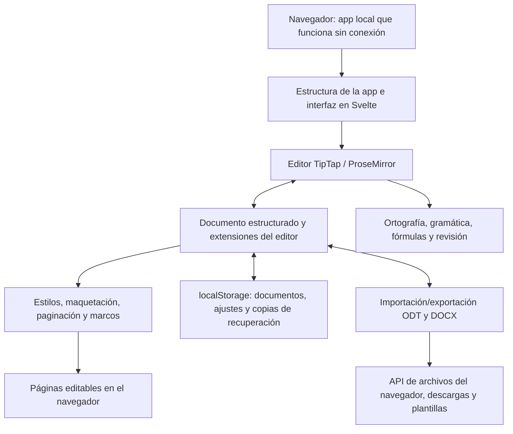

<p align="center">
  
</p>

<h1 align="center">
  
</h1>

<p align="center">
  <strong>Un potente procesador de textos, a una URL de distancia.</strong><br>
  Gratuito · Código abierto · Privacidad desde el diseño
</p>

<p align="center">
  <a href="https://github.com/stffnb/edentext/actions/workflows/ci.yml"></a>
  <a href="LICENSE"></a>
  <a href="CHANGELOG.md"></a>
  
</p>

<p align="center">
  <a href="https://edentext.app"><strong>▶ Abrir EdenText</strong></a>
</p>

<p align="center">
  <a href="README.md">English</a> · <a href="README.de.md">Deutsch</a> · <b>Español</b> · <a href="README.fr.md">Français</a> · <a href="README.ru.md">Русский</a> · <a href="README.uk.md">Українська</a> · <a href="README.zh-CN.md">简体中文</a>
</p>

<picture>
  <source media="(prefers-color-scheme: dark)" srcset="docs/hero-dark.webp">
  
</picture>

---

EdenText es un potente procesador de textos que funciona en el navegador y sirve para todo: desde notas rápidas hasta libros completos. Sin servidor ni cuenta: todo se procesa en local y tus documentos nunca salen de tu equipo. Basta con abrir una URL, o puedes usarlo totalmente sin conexión como una app ligera del navegador: en la mayoría de los idiomas arranca con menos de 2 MB de descarga, y los diccionarios y las fuentes llegan cuando hacen falta[^1]. La interfaz está disponible en inglés, alemán, español, francés, portugués, griego, ruso, ucraniano, japonés y chino (simplificado y tradicional).

> [!NOTE]
> EdenText es joven, está en **beta** y en desarrollo activo; hay más funciones en
> camino. Está probado (la suite completa y las comprobaciones de ida y vuelta con
> LibreOffice se ejecutan en cada commit), pero puede haber algún error ocasional, así
> que guarda copias de seguridad de los documentos que te importen. Además, la copia del
> navegador conserva las tres últimas versiones del documento abierto y te las ofrece si
> alguna vez no se puede cargar.
>
> **¿Encontraste un error, o un documento no se ve como debería?**
> [Abre una issue](https://github.com/stffnb/edentext/issues): cada informe ayuda. Son
> especialmente bienvenidos los documentos que EdenText muestra de forma distinta a Word,
> LibreOffice o WPS Office: adjunta el archivo (o una copia reducida) y se convertirá en
> un caso de prueba.

<a href="https://edentext.app"><picture>
  <source media="(prefers-color-scheme: dark)" srcset="docs/showcase/thesis-dark.png">
  
</picture></a>

## Funciones

- **Maquetación de página de verdad** — páginas A4/Carta, márgenes, encabezados y pies de
  página, notas al pie, columnas, numeración de páginas y de líneas, marcas de agua; para
  libros, márgenes simétricos y capítulos que empiezan en página impar
- **Abre y guarda `.odt` y `.docx`**, exporta a PDF; plantillas (`.ott`/`.dotx`) y una
  galería de cartas (DIN 5008); archivos protegidos con contraseña en ambos formatos
- **Compatible con Word y LibreOffice** — los documentos conservan su maquetación en los
  tres, algo que comprueban pruebas automáticas de ida y vuelta y de maquetación
- **Estilos** — de párrafo, de carácter, de tabla y de lista, con herencia; numeración de
  capítulos
- **Tablas** con estilos, ordenación y fórmulas como en una hoja de cálculo
- **Todo lo que necesita una tesis** — índice general, leyendas, referencias cruzadas,
  citas y bibliografía, índice alfabético, fórmulas (LaTeX)
- **Herramientas de revisión** — control de cambios e hilos de comentarios en globos al
  margen, marcas imprimibles, corrector ortográfico (inglés, alemán, español, francés,
  portugués, griego, ruso y ucraniano), sinónimos (todos ellos menos el griego), corrector
  gramatical (inglés)
- **Asistente de IA opcional** — con tu propio proveedor o un modelo local; responde
  preguntas sobre el documento y lo edita como cambios controlados. Se puede desactivar;
  las solicitudes van directamente al proveedor, sin pasar por ningún servidor de EdenText
- **Privacidad desde el diseño** — tus documentos nunca salen de tu equipo y todo se
  procesa en local; funciona sin conexión como app instalable. El sitio web cuenta las
  visitas de forma anónima (GoatCounter, alojado en la UE, sin cookies); el editor no
  envía nada, salvo que actives el asistente de IA, que envía al proveedor que hayas
  elegido. Los documentos se guardan automáticamente en el navegador; «Documentos
  recientes» puede descartar los que se cerraron al siguiente inicio o no guardarlos ahí
  en absoluto, y una ventana privada no deja rastro al cerrarla
- **Cualquier navegador actual** — en Chrome y Edge, «Guardar» escribe en el archivo
  abierto, y en Brave también una vez activado `brave://flags/#file-system-access-api`;
  en los demás casos cada guardado es una descarga, así que activa en los ajustes del
  navegador «Preguntar dónde se guardará cada archivo antes de descargarlo» para elegir
  la ubicación

Los puntos en los que el navegador impide que EdenText se vea exactamente como Word o
LibreOffice se describen en [Known limitations](CHANGELOG.md#known-limitations) (en inglés).

## Galería

Los documentos de estas imágenes están en [`docs/showcase/`](docs/showcase/) en `.odt` y
`.docx`, listos para abrir en EdenText, LibreOffice o Word. Los genera
`scripts/showcase/run.mjs`; las fotografías son de la NASA y el libro es de Lewis Carroll,
ambos de dominio público.

<table>
<tr>
<td width="50%" valign="top"><a href="docs/showcase/thesis-review.png"></a><br><b>Revisión</b> — control de cambios, hilos de comentarios al margen, una marca de agua de borrador</td>
<td width="50%" valign="top"><a href="docs/showcase/book-spread.png"></a><br><b>Libro</b> — A5, márgenes simétricos, capítulos que empiezan en página impar, titulillos; la numeración se reinicia tras las páginas preliminares, por eso la página 11 lleva el folio 9</td>
</tr>
<tr>
<td width="50%" valign="top"><a href="docs/showcase/newsletter.png"></a><br><b>Boletín</b> — columnas, imágenes con leyenda, un recuadro lateral</td>
<td width="50%" valign="top"><a href="docs/showcase/newsletter-tables.png"></a><br><b>Tablas</b> — estilos de tabla y fórmulas como en una hoja de cálculo</td>
</tr>
</table>

## Aplicación de escritorio

Cada versión incluye además instaladores de escritorio sin firmar, creados con Electron:

- **macOS** — `EdenText-<version>-arm64.dmg` (Apple Silicon) o `EdenText-<version>.dmg` (Intel).
  Arrastra la app a Aplicaciones. Como no está firmada, ábrela la primera vez con clic
  derecho → Abrir, o ejecuta `xattr -d com.apple.quarantine /Applications/EdenText.app`.
- **Windows** — `EdenText-Setup-<version>.exe`. SmartScreen avisa de un editor
  desconocido: Más información → Ejecutar de todas formas.
- **Linux** — `EdenText-<version>.AppImage` (`chmod +x` y luego ejecútalo) o el `.deb`
  (`sudo apt install ./edentext_*.deb`).

## Desarrollo

```bash
npm install
npm run dev      # servidor de desarrollo con recarga en caliente
npm test         # suite de pruebas
npm run build    # compilación de producción → dist/
cd desktop && npm install && npm start   # app de escritorio sobre la misma compilación
```

Creado con Svelte 5, TypeScript, Vite y TipTap 3 (ProseMirror).

## Autoalojamiento

No hay backend ni estado en el servidor; los documentos se quedan en el navegador.
Con cada versión se publica una imagen de contenedor (amd64 y arm64):

```bash
docker run -p 8080:80 ghcr.io/stffnb/edentext
```

O sirve los archivos por tu cuenta: cada versión incluye un `edentext-<tag>.zip` con la
app compilada, y `npm run build` genera la misma carpeta en `dist/`; apunta a ella
cualquier servidor web, o crea la imagen en local con `docker build -t edentext .`.

## Arquitectura



EdenText funciona por completo en el navegador: `App.svelte` compone la interfaz en torno
al modelo de documento de TipTap y sus extensiones. Los estilos y la maquetación convierten
ese modelo en páginas editables; el almacenamiento guarda el estado local y las copias de
recuperación. La importación y la exportación traducen ese mismo modelo a ODT y DOCX, y las
API de archivos del navegador guardan o descargan los archivos resultantes. Las invariantes
de formato y maquetación se describen en las [guías de arquitectura](docs/architecture/) (en inglés).

## Contribuir

Las contribuciones son bienvenidas: consulta [CONTRIBUTING.md](CONTRIBUTING.md) (en
inglés). Para fusionar hace falta haber firmado el [CLA](CLA.md), algo que se comprueba
automáticamente en cada pull request.

### Agradecimientos

Gracias a todas las personas que han ayudado con ideas, informes de errores, pruebas y
comentarios:

- Patrick R. — pruebas alfa y beta
- [@Deleh](https://github.com/Deleh) — pruebas beta

## Licencia

Copyright © 2026 Steffen Becker · Hecho en Alemania

[AGPL-3.0](LICENSE). Hay una [licencia comercial](LICENSE.commercial.md) para los casos de
uso a los que no se ajusta la AGPL. Las fuentes y los datos lingüísticos incluidos conservan
sus propias licencias: consulta [THIRD-PARTY-NOTICES.md](THIRD-PARTY-NOTICES.md).

*EdenText es un proyecto independiente, sin relación con Microsoft ni con The Document
Foundation. `.docx` y `.odt` se admiten por interoperabilidad.*

*Esta es una traducción del [README](README.md) en inglés; en caso de discrepancia, prevalece la versión inglesa.*

[^1]: Transferencia por red, comprimida: ~0,7 MB de código de la app; el resto es el
    corrector ortográfico con el diccionario del idioma del navegador y las fuentes que
    muestra una página. Los diccionarios de griego y ucraniano añaden ~2,5 y ~1,5 MB.
    Todo lo demás se descarga cuando hace falta y se conserva para usarlo sin conexión;
    todas las fuentes, diccionarios y tesauros juntos suman ~18 MB, o ~26 MB con el
    corrector gramatical de inglés.
