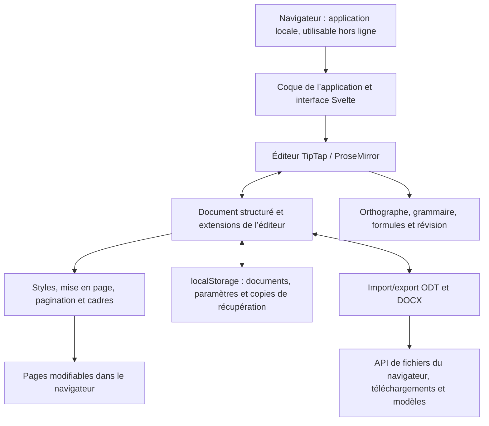

<p align="center">
  
</p>

<h1 align="center">
  
</h1>

<p align="center">
  <strong>Un traitement de texte puissant, à portée d’URL.</strong><br>
  Gratuit · Open source · Private by Design
</p>

<p align="center">
  <a href="https://github.com/stffnb/edentext/actions/workflows/ci.yml"></a>
  <a href="LICENSE"></a>
  <a href="CHANGELOG.md"></a>
  
</p>

<p align="center">
  <a href="https://edentext.app"><strong>▶ Ouvrir EdenText</strong></a>
</p>

<p align="center">
  <a href="README.md">English</a> · <a href="README.de.md">Deutsch</a> · <a href="README.es.md">Español</a> · <b>Français</b> · <a href="README.ru.md">Русский</a> · <a href="README.uk.md">Українська</a> · <a href="README.zh-CN.md">简体中文</a>
</p>

<picture>
  <source media="(prefers-color-scheme: dark)" srcset="docs/hero-dark.webp">
  
</picture>

---

EdenText est un traitement de texte puissant qui s’utilise dans le navigateur, de la note rapide au livre entier. Ni serveur ni compte : tout est traité en local et vos documents ne quittent jamais votre ordinateur. Il suffit d’ouvrir une URL – ou de l’utiliser entièrement hors ligne comme application de navigateur légère : pour la plupart des langues, moins de 2 Mo suffisent au premier lancement, les dictionnaires et les polices suivent au besoin[^1]. L’interface est disponible en anglais, allemand, espagnol, français, portugais, grec, russe, ukrainien, japonais et chinois (simplifié et traditionnel).

> [!NOTE]
> EdenText est jeune, en **bêta** et activement développé – d’autres fonctionnalités
> arrivent. Il est testé – la suite complète et des vérifications d’aller-retour avec
> LibreOffice tournent à chaque commit –, mais attendez-vous à quelques bugs et gardez
> des sauvegardes des documents qui comptent pour vous. La copie dans le navigateur
> conserve en outre les trois dernières versions du document ouvert et vous les propose
> si jamais il ne se charge plus.
>
> **Vous avez trouvé un bug, ou un document ne s’affiche pas correctement ?** Merci
> d’[ouvrir une issue](https://github.com/stffnb/edentext/issues) – chaque signalement aide.
> Les documents qu’EdenText affiche autrement que Word, LibreOffice ou WPS Office sont
> particulièrement bienvenus : joignez le fichier (ou une copie allégée) et il deviendra
> un cas de test.

<a href="https://edentext.app"><picture>
  <source media="(prefers-color-scheme: dark)" srcset="docs/showcase/thesis-dark.png">
  
</picture></a>

## Fonctionnalités

- **Une vraie mise en page** – pages A4/Letter, marges, en-têtes et pieds de page, notes
  de bas de page, colonnes, numérotation des pages et des lignes, filigranes ; pour les
  livres, marges en miroir et chapitres qui commencent sur une page de droite
- **Ouvre et enregistre `.odt` et `.docx`**, exporte en PDF ; modèles (`.ott`/`.dotx`) et
  galerie de lettres (DIN 5008) ; fichiers protégés par mot de passe dans les deux formats
- **Compatible avec Word et LibreOffice** – les documents gardent leur mise en page dans
  les trois, ce que vérifient des tests automatisés d’aller-retour et de mise en page
- **Styles** – styles de paragraphe, de caractère, de tableau et de liste avec héritage,
  numérotation des chapitres
- **Tableaux** avec styles, tri et formules façon tableur
- **Tout ce qu’il faut pour un mémoire ou une thèse** – table des matières, légendes,
  renvois, citations et bibliographie, index alphabétique, formules (LaTeX)
- **Outils de révision** – suivi des modifications et fils de commentaires dans des bulles
  en marge, annotations imprimables, correction orthographique (anglais, allemand,
  espagnol, français, portugais, grec, russe et ukrainien), synonymes (toutes ces langues
  sauf le grec), correction grammaticale (anglais)
- **Assistant IA facultatif** – avec le fournisseur de votre choix ou un modèle local ; il
  répond aux questions sur le document et le modifie sous forme de modifications suivies.
  Il peut être désactivé ; les requêtes vont directement au fournisseur, sans passer par
  un serveur EdenText
- **Private by Design** – vos documents ne quittent jamais votre
  ordinateur, tout est traité en local ; fonctionne hors ligne comme application
  installable. Le site compte les visites de façon anonyme (GoatCounter, hébergé dans
  l’UE, sans cookies) ; l’éditeur n’envoie rien, sauf si vous activez l’assistant IA, qui
  envoie alors au fournisseur choisi. Les documents sont enregistrés automatiquement dans
  le navigateur ; « Documents récents » peut oublier les documents fermés au démarrage
  suivant, ou ne pas les y enregistrer du tout, et une fenêtre de navigation privée ne
  laisse aucune trace une fois fermée
- **Tous les navigateurs actuels** – dans Chrome et Edge, « Enregistrer » écrit dans le
  fichier ouvert, et Brave aussi une fois `brave://flags/#file-system-access-api` activé ;
  sinon, chaque enregistrement est un téléchargement : activez alors dans les paramètres du
  navigateur « Demander dans quel dossier enregistrer chaque fichier avant de le
  télécharger » pour choisir l’emplacement

Les cas où le navigateur empêche EdenText de reproduire exactement Word ou LibreOffice sont
décrits dans [Known limitations](CHANGELOG.md#known-limitations) (en anglais).

## Galerie

Les documents derrière ces images se trouvent dans [`docs/showcase/`](docs/showcase/) en
`.odt` et `.docx`, prêts à être ouverts dans EdenText, LibreOffice ou Word. Ils sont générés
par `scripts/showcase/run.mjs` ; les photos viennent de la NASA et le livre est de Lewis
Carroll, tous deux dans le domaine public.

<table>
<tr>
<td width="50%" valign="top"><a href="docs/showcase/thesis-review.png"></a><br><b>Révision</b> – suivi des modifications, fils de commentaires en marge, filigrane « brouillon »</td>
<td width="50%" valign="top"><a href="docs/showcase/book-spread.png"></a><br><b>Livre</b> – A5, marges en miroir, chapitres qui commencent sur une page de droite, titres courants ; la numérotation reprend après les pages liminaires, si bien que la page 11 porte le folio 9</td>
</tr>
<tr>
<td width="50%" valign="top"><a href="docs/showcase/newsletter.png"></a><br><b>Lettre d’information</b> – colonnes, images légendées, encadré latéral</td>
<td width="50%" valign="top"><a href="docs/showcase/newsletter-tables.png"></a><br><b>Tableaux</b> – styles de tableau et formules façon tableur</td>
</tr>
</table>

## Application de bureau

Chaque version est aussi livrée avec des installateurs de bureau non signés, construits avec Electron :

- **macOS** – `EdenText-<version>-arm64.dmg` (Apple Silicon) ou `EdenText-<version>.dmg` (Intel).
  Glissez l’application dans Applications. Comme elle n’est pas signée, ouvrez-la la première
  fois par clic droit → Ouvrir, ou exécutez `xattr -d com.apple.quarantine /Applications/EdenText.app`.
- **Windows** – `EdenText-Setup-<version>.exe`. SmartScreen signale un éditeur inconnu :
  Informations complémentaires → Exécuter quand même.
- **Linux** – `EdenText-<version>.AppImage` (`chmod +x`, puis lancez-le) ou le `.deb`
  (`sudo apt install ./edentext_*.deb`).

## Développement

```bash
npm install
npm run dev      # serveur de développement avec rechargement à chaud
npm test         # suite de tests
npm run build    # build de production → dist/
cd desktop && npm install && npm start   # application de bureau sur le même build
```

Construit avec Svelte 5, TypeScript, Vite et TipTap 3 (ProseMirror).

## Auto-hébergement

Il n’y a ni backend ni état côté serveur ; les documents restent dans le navigateur.
Une image de conteneur est publiée pour chaque version (amd64 et arm64) :

```bash
docker run -p 8080:80 ghcr.io/stffnb/edentext
```

Ou servez les fichiers vous-même : chaque version comprend un `edentext-<tag>.zip` de
l’application construite, et `npm run build` produit le même dossier dans `dist/` – il
suffit d’y faire pointer n’importe quel serveur web, ou de construire l’image en local avec
`docker build -t edentext .`.

## Architecture



EdenText fonctionne entièrement dans le navigateur : `App.svelte` assemble l’interface
autour du modèle de document TipTap et de ses extensions. Les styles et la mise en page
transforment ce modèle en pages modifiables ; le stockage conserve l’état local et les
copies de récupération. L’import et l’export traduisent ce même modèle en ODT et DOCX, et
les API de fichiers du navigateur enregistrent ou téléchargent les fichiers obtenus. Les
invariants de format et de mise en page sont décrits dans les
[guides d’architecture](docs/architecture/) (en anglais).

## Contribuer

Les contributions sont les bienvenues – voir [CONTRIBUTING.md](CONTRIBUTING.md) (en
anglais). Une fusion nécessite un [CLA](CLA.md) signé, vérifié automatiquement à chaque
pull request.

### Remerciements

Merci à toutes celles et tous ceux qui ont aidé par leurs idées, leurs signalements de
bugs, leurs tests et leurs retours :

- Patrick R. – tests alpha et bêta
- [@Deleh](https://github.com/Deleh) – tests bêta

## Licence

Copyright © 2026 Steffen Becker · Fabriqué en Allemagne

[AGPL-3.0](LICENSE). Une [licence commerciale](LICENSE.commercial.md) est disponible pour
les usages auxquels l’AGPL ne convient pas. Les polices et données linguistiques fournies
conservent leurs propres licences – voir [THIRD-PARTY-NOTICES.md](THIRD-PARTY-NOTICES.md).

*EdenText est un projet indépendant, sans lien avec Microsoft ni avec The Document
Foundation. Les formats `.docx` et `.odt` sont pris en charge à des fins d’interopérabilité.*

*Ceci est une traduction du [README](README.md) anglais ; en cas de divergence, la version anglaise fait foi.*

[^1]: Volume transféré, compressé : ~0,7 Mo de code d’application, le reste étant le
    correcteur orthographique avec le dictionnaire de la langue du navigateur et les
    polices qu’affiche une page ; les dictionnaires grec et ukrainien ajoutent ~2,5 et
    ~1,5 Mo. Tout le reste est téléchargé à la première utilisation puis conservé pour le
    hors-ligne ; l’ensemble des polices, dictionnaires et thésaurus pèse ~18 Mo, ou ~26 Mo
    avec la correction grammaticale anglaise.
