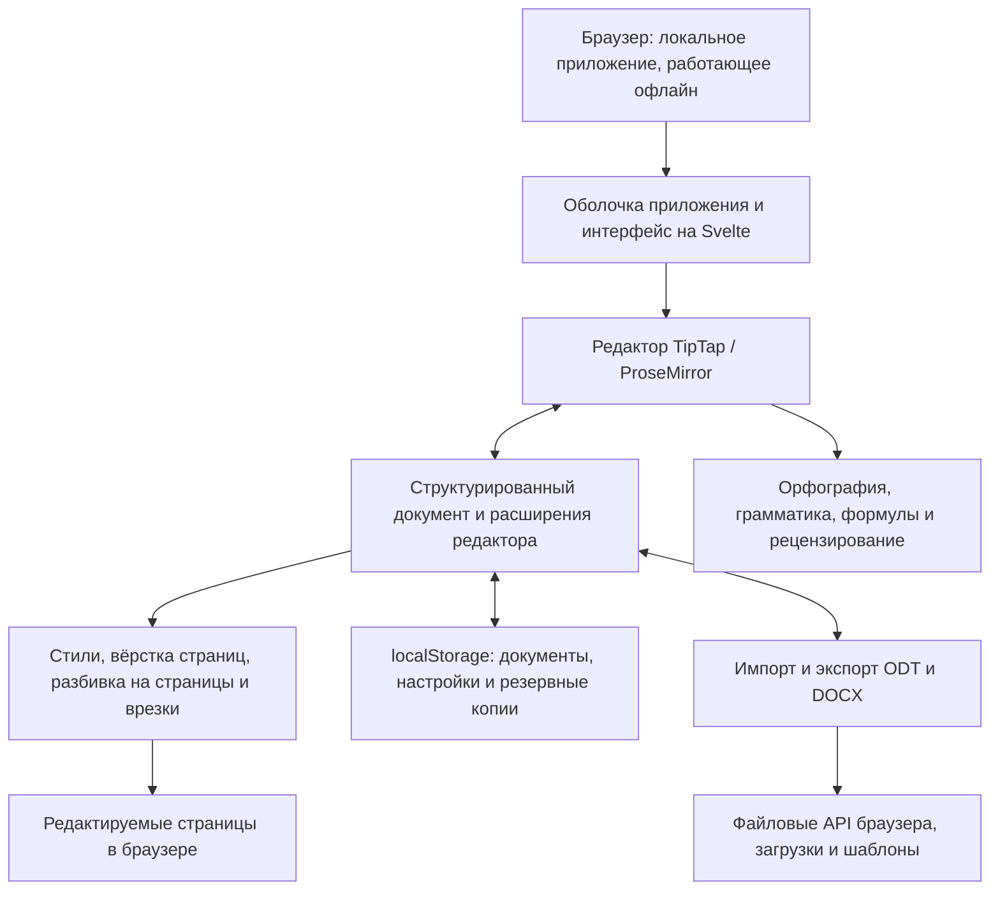

<p align="center">
  
</p>

<h1 align="center">
  
</h1>

<p align="center">
  <strong>Полноценный текстовый процессор прямо в браузере</strong><br>
  Бесплатно · Открытый исходный код · Private by Design
</p>

<p align="center">
  <a href="https://github.com/stffnb/edentext/actions/workflows/ci.yml"></a>
  <a href="LICENSE"></a>
  <a href="CHANGELOG.md"></a>
  
</p>

<p align="center">
  <a href="https://edentext.app"><strong>▶ Открыть EdenText</strong></a>
</p>

<p align="center">
  <a href="README.md">English</a> · <a href="README.de.md">Deutsch</a> · <a href="README.es.md">Español</a> · <a href="README.fr.md">Français</a> · <a href="README.pt.md">Português</a> · <a href="README.el.md">Ελληνικά</a> · <b>Русский</b> · <a href="README.uk.md">Українська</a> · <a href="README.ja.md">日本語</a> · <a href="README.zh-CN.md">简体中文</a> · <a href="README.zh-TW.md">繁體中文</a>
</p>

<picture>
  <source media="(prefers-color-scheme: dark)" srcset="docs/hero-dark.webp">
  
</picture>

---

EdenText — мощный текстовый процессор в браузере для всего: от быстрых заметок до целых книг. Без сервера и без учётной записи — вся обработка идёт локально, и документы никогда не покидают компьютер. Достаточно открыть ссылку или установить EdenText как приложение и работать офлайн. Для большинства языков при первом запуске загружается около 2 МБ, словари и шрифты подгружаются по мере необходимости[^1]. Интерфейс доступен на английском, немецком, испанском, французском, португальском, греческом, русском, украинском, японском и китайском (упрощённом и традиционном) языках.

> [!NOTE]
> EdenText пока в **бете** и активно развивается. Тесты и проверки обмена
> подтверждают его работу. Тем не менее на текущем этапе ошибки не исключены, поэтому храните
> резервные копии важных документов. Кроме того, браузер хранит три последние версии
> открытого документа на случай, если он не загрузится.
>
> **Нашли ошибку или документ выглядит не так, как надо?** Пожалуйста,
> [создайте issue](https://github.com/stffnb/edentext/issues), это очень помогает.
> Особенно ценны документы, которые в EdenText выглядят иначе, чем в Word, LibreOffice
> или WPS Office: приложите файл (или сокращённую копию), и он станет тестовым примером.

<a href="https://edentext.app"><picture>
  <source media="(prefers-color-scheme: dark)" srcset="docs/showcase/thesis-dark.png">
  
</picture></a>

## Возможности

- **Настоящая вёрстка страниц** — страницы A4/Letter, поля, колонтитулы, сноски,
  колонки, нумерация страниц и строк, водяные знаки; зеркальные поля и главы,
  начинающиеся с правой страницы, для книг
- **Открывает и сохраняет `.odt` и `.docx`**, экспортирует в PDF; шаблоны (`.ott`/`.dotx`)
  и галерея писем (DIN 5008); защищённые паролем файлы в обоих форматах
- **Совместимость с Word и LibreOffice** — документы сохраняют вёрстку во всех трёх
  программах, что подтверждается автоматическими тестами обмена и вёрстки
- **Стили** — стили абзацев, символов, таблиц и списков с наследованием,
  нумерация глав
- **Таблицы** со стилями, сортировкой и формулами как в электронных таблицах
- **Всё, что нужно для диссертации** — оглавление, подписи, перекрёстные ссылки,
  цитаты и список литературы, алфавитный указатель, формулы (LaTeX)
- **Инструменты рецензирования** — отслеживание изменений и ветки комментариев
  с выносками на полях, печать исправлений, проверка орфографии (английский,
  немецкий, испанский, французский, португальский, греческий, русский и украинский),
  синонимы (все эти языки, кроме греческого), проверка грамматики (английский)
- **Необязательный ИИ-ассистент** — с любым провайдером на выбор или локальной
  моделью; отвечает на вопросы о документе и редактирует его в режиме отслеживания
  изменений. Его можно отключить; запросы идут напрямую провайдеру, без сервера EdenText
- **Private by Design** — документы никогда не покидают компьютер, вся обработка идёт
  локально; после установки приложение работает офлайн. Сайт считает анонимные
  посещения (GoatCounter, хостинг в ЕС, без cookie); сам редактор ничего не отправляет,
  кроме запросов выбранному провайдеру при включённом ИИ-ассистенте. Документы
  автоматически сохраняются в браузере; в «Последних документах» можно настроить, чтобы
  закрытые документы удалялись при следующем запуске или вовсе не сохранялись.
  Приватное окно после закрытия не оставляет следов
- **Любой современный браузер** — в Chrome и Edge «Сохранить» записывает изменения
  в открытый файл, в Brave тоже — после включения
  `brave://flags/#file-system-access-api`; в остальных случаях каждое сохранение —
  это загрузка. Чтобы выбирать место сохранения, включите в настройках браузера
  «Всегда указывать место для скачивания»

Где браузер не позволяет EdenText в точности повторить Word или LibreOffice,
описано в разделе [Known limitations](CHANGELOG.md#known-limitations) (на английском).

## Галерея

Документы, по которым сделаны эти изображения, лежат в [`docs/showcase/`](docs/showcase/)
в форматах `.odt` и `.docx` — их можно сразу открыть в EdenText, LibreOffice или Word.
Они создаются скриптом `scripts/showcase/run.mjs`; фотографии принадлежат NASA, а книга —
Льюису Кэрроллу, всё это общественное достояние.

<table>
<tr>
<td width="50%" valign="top"><a href="docs/showcase/thesis-review.png"></a><br><b>Рецензирование</b> — отслеживание изменений, ветки комментариев на полях, водяной знак «черновик»</td>
<td width="50%" valign="top"><a href="docs/showcase/book-spread.png"></a><br><b>Книга</b> — A5, зеркальные поля, главы с правой страницы, колонтитулы; после вводной части нумерация начинается заново, поэтому на 11-й странице стоит номер 9</td>
</tr>
<tr>
<td width="50%" valign="top"><a href="docs/showcase/newsletter.png"></a><br><b>Бюллетень</b> — колонки, изображения с подписями, врезка на полях</td>
<td width="50%" valign="top"><a href="docs/showcase/newsletter-tables.png"></a><br><b>Таблицы</b> — стили таблиц и формулы как в электронных таблицах</td>
</tr>
</table>

## Настольное приложение

К каждому релизу также прилагаются неподписанные установщики, собранные на Electron:

- **macOS** — `EdenText-<version>-arm64.dmg` (Apple silicon) или `EdenText-<version>.dmg` (Intel).
  Перетащите приложение в «Программы». Поскольку оно не подписано, в первый раз откройте
  его через правый клик → «Открыть» или выполните `xattr -d com.apple.quarantine /Applications/EdenText.app`.
- **Windows** — `EdenText-Setup-<version>.exe`. SmartScreen предупредит о неизвестном
  издателе: «Подробнее» → «Выполнить в любом случае».
- **Linux** — `EdenText-<version>.AppImage` (`chmod +x`, затем запустить) или `.deb`
  (`sudo apt install ./edentext_*.deb`).

Настольное приложение открывает документы из файлового менеджера и сохраняет обратно в них,
записывает PDF напрямую без диалога печати и при запуске сообщает о выходе новой версии.

## Разработка

```bash
npm install
npm run dev      # dev-сервер с горячей перезагрузкой
npm test         # набор тестов
npm run build    # продакшен-сборка → dist/
cd desktop && npm install && npm start   # настольное приложение на той же сборке
```

Создано на Svelte 5, TypeScript, Vite и TipTap 3 (ProseMirror).

## Собственный хостинг

Бэкенда нет, на сервере не хранится никакого состояния; документы остаются в браузере.
Для каждого релиза публикуется образ контейнера (amd64 и arm64):

```bash
docker run -p 8080:80 ghcr.io/stffnb/edentext
```

Можно и без Docker: к каждому релизу прилагается `edentext-<tag>.zip` с готовым
приложением (`npm run build` создаёт то же самое в `dist/`). Эту папку может раздавать
любой веб-сервер. Образ можно собрать и локально: `docker build -t edentext .`.

При обновлении копируйте новые файлы поверх старых, а не очищайте папку: вкладки,
открытые до обновления, до перезагрузки продолжают загружать файлы своей версии.
На отсутствующий файл сервер должен отвечать 404, а не `index.html`, чтобы такая вкладка
могла предложить перезагрузку.

## Архитектура



EdenText работает целиком в браузере: `App.svelte` строит интерфейс вокруг модели
документа TipTap и её расширений. Стили и вёрстка превращают эту модель в редактируемые
страницы; хранилище держит локальное состояние и резервные копии. Импорт и экспорт
переводят ту же модель в ODT и DOCX, а файловые API браузера сохраняют или загружают
полученные файлы. Подробнее о форматах и вёрстке — в
[архитектурной документации](docs/architecture/) (на английском).

## Участие в разработке

Будем рады вашему участию — см. [CONTRIBUTING.md](CONTRIBUTING.md) (на английском). Для слияния
нужно подписать [CLA](CLA.md); это автоматически проверяется в каждом pull request.

### Участники

Спасибо всем, кто помог идеями, сообщениями об ошибках, тестированием и отзывами:

- Patrick R. — альфа- и бета-тестирование
- [@Deleh](https://github.com/Deleh) — бета-тестирование

## Лицензия

Copyright © 2026 Steffen Becker · Сделано в Германии

[AGPL-3.0](LICENSE). Если AGPL не подходит, есть
[коммерческая лицензия](LICENSE.commercial.md). Входящие в комплект шрифты и языковые
данные сохраняют свои лицензии — см. [THIRD-PARTY-NOTICES.md](THIRD-PARTY-NOTICES.md).

*EdenText — независимый проект, не связанный с Microsoft или The Document Foundation.
Форматы `.docx` и `.odt` поддерживаются для совместимости.*

*Это перевод английского [README](README.md); при расхождениях действует английская версия.*

[^1]: Объём передачи по сети в сжатом виде: ~0,9 МБ кода приложения, остальное — модуль
    проверки орфографии со словарём языка браузера и шрифты, которые показывает страница;
    греческий и украинский словари добавляют ~2,5 и ~1,5 МБ. Всё остальное загружается
    при первой необходимости и сохраняется для работы офлайн; все шрифты, словари
    и тезаурусы вместе занимают ~18 МБ, а с проверкой грамматики английского — ~26 МБ.
