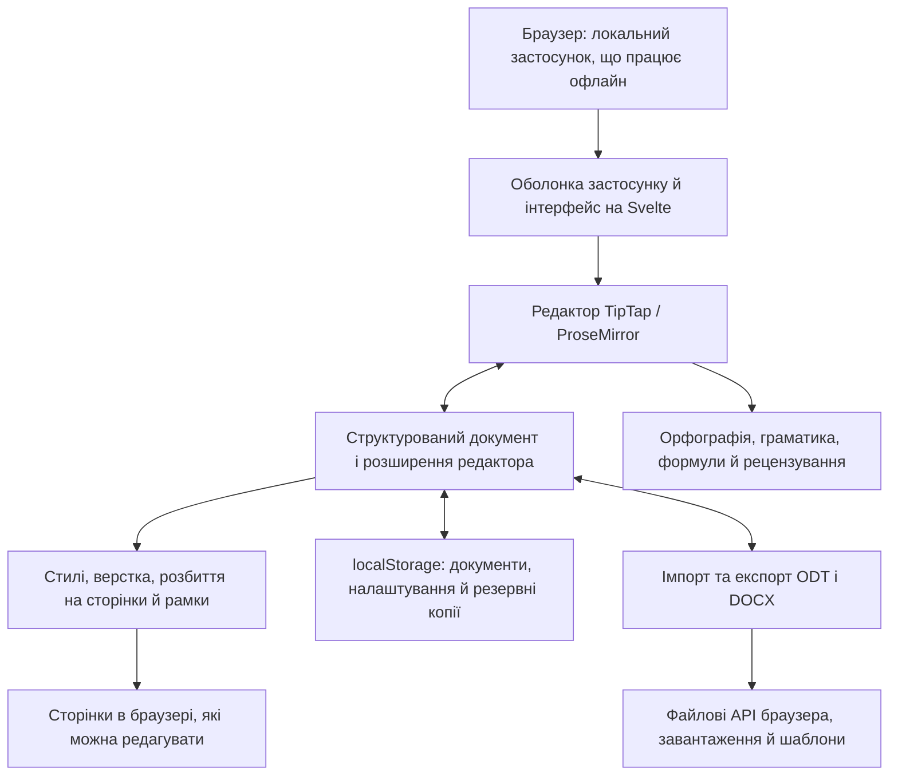

<p align="center">
  
</p>

<h1 align="center">
  
</h1>

<p align="center">
  <strong>Повноцінний текстовий процесор просто в браузері</strong><br>
  Безкоштовно · Відкритий код · Private by Design
</p>

<p align="center">
  <a href="https://github.com/stffnb/edentext/actions/workflows/ci.yml"></a>
  <a href="LICENSE"></a>
  <a href="CHANGELOG.md"></a>
  
</p>

<p align="center">
  <a href="https://edentext.app"><strong>▶ Відкрити EdenText</strong></a>
</p>

<p align="center">
  <a href="README.md">English</a> · <a href="README.de.md">Deutsch</a> · <a href="README.es.md">Español</a> · <a href="README.fr.md">Français</a> · <a href="README.pt.md">Português</a> · <a href="README.el.md">Ελληνικά</a> · <a href="README.ru.md">Русский</a> · <b>Українська</b> · <a href="README.ja.md">日本語</a> · <a href="README.zh-CN.md">简体中文</a> · <a href="README.zh-TW.md">繁體中文</a>
</p>

<picture>
  <source media="(prefers-color-scheme: dark)" srcset="docs/hero-dark.webp">
  
</picture>

---

EdenText — потужний текстовий процесор у браузері для всього: від швидких нотаток до цілих книжок. Без сервера й без облікового запису — усе обробляється локально, і документи ніколи не залишають комп’ютера. Досить відкрити посилання або встановити EdenText як застосунок і працювати офлайн. Для більшості мов під час першого запуску завантажується близько 2 МБ, а словники й шрифти довантажуються за потреби[^1]. Інтерфейс доступний англійською, німецькою, іспанською, французькою, португальською, грецькою, російською, українською, японською та китайською (спрощеною й традиційною) мовами.

> [!NOTE]
> EdenText поки що в **беті** й активно розвивається. Тести й перевірки обміну
> підтверджують його роботу. Проте на цьому етапі помилки не виключені, тож зберігайте резервні копії важливих документів. Крім того, браузер зберігає три
> останні версії відкритого документа на випадок, якщо він не завантажиться.
>
> **Знайшли помилку або документ виглядає не так, як має?** Будь ласка,
> [створіть issue](https://github.com/stffnb/edentext/issues), це дуже допомагає.
> Особливо цінні документи, які в EdenText виглядають інакше, ніж у Word, LibreOffice чи
> WPS Office: додайте файл (або скорочену копію), і він стане тестовим прикладом.

<a href="https://edentext.app"><picture>
  <source media="(prefers-color-scheme: dark)" srcset="docs/showcase/thesis-dark.png">
  
</picture></a>

## Можливості

- **Справжня верстка сторінок** — сторінки A4/Letter, поля, колонтитули, виноски, колонки,
  нумерація сторінок і рядків, водяні знаки; для книжок — дзеркальні поля й розділи, що
  починаються з правої сторінки
- **Відкриває та зберігає `.odt` і `.docx`**, експортує в PDF; шаблони (`.ott`/`.dotx`)
  і галерея листів (DIN 5008); захищені паролем файли в обох форматах
- **Сумісність із Word і LibreOffice** — документи зберігають верстку в усіх трьох
  програмах, що підтверджують автоматичні тести обміну й верстки
- **Стилі** — стилі абзаців, символів, таблиць і списків зі спадкуванням, нумерація розділів
- **Таблиці** зі стилями, сортуванням і формулами, як в електронних таблицях
- **Усе для дипломної роботи чи дисертації** — зміст, підписи, перехресні посилання,
  цитування й список літератури, предметний покажчик, формули (LaTeX)
- **Рецензування** — відстеження змін і гілки коментарів у виносках на полях, друк
  виправлень, перевірка орфографії (англійська, німецька, іспанська, французька,
  португальська, грецька, російська та українська), синоніми (усі ці мови, крім
  грецької), перевірка граматики (англійська)
- **Необов’язковий ШІ-асистент** — з будь-яким провайдером на вибір або локальною моделлю;
  відповідає на запитання про документ і редагує його з відстеженням змін. Його можна
  вимкнути; запити йдуть безпосередньо до провайдера, без сервера EdenText
- **Private by Design** — документи ніколи не залишають комп’ютера, усе обробляється
  локально; після встановлення застосунок працює офлайн. Сайт рахує анонімні відвідування
  (GoatCounter, хостинг у ЄС, без cookie); сам редактор нічого не надсилає, окрім запитів
  до обраного провайдера, коли ввімкнено ШІ-асистента. Документи автоматично зберігаються
  в браузері; в «Останніх документах» можна налаштувати, щоб закриті документи видалялися
  під час наступного запуску або взагалі не зберігалися. Приватне вікно після закриття не
  залишає слідів
- **Будь-який сучасний браузер** — у Chrome і Edge «Зберегти» записує зміни у відкритий
  файл, у Brave теж — після ввімкнення `brave://flags/#file-system-access-api`; в інших
  випадках кожне збереження — це завантаження. Щоб обирати місце, увімкніть у
  налаштуваннях браузера «Запитувати, де зберігати кожен файл перед завантаженням»

Де браузер не дає EdenText точно відтворити Word чи LibreOffice, описано в розділі
[Known limitations](CHANGELOG.md#known-limitations) (англійською).

## Галерея

Документи, з яких зроблено ці зображення, лежать у [`docs/showcase/`](docs/showcase/)
у форматах `.odt` і `.docx` — їх можна одразу відкрити в EdenText, LibreOffice чи Word.
Їх створює скрипт `scripts/showcase/run.mjs`; фотографії належать NASA, а книжка —
Льюїсу Керроллу, усе це суспільне надбання.

<table>
<tr>
<td width="50%" valign="top"><a href="docs/showcase/thesis-review.png"></a><br><b>Рецензування</b> — відстеження змін, гілки коментарів на полях, водяний знак «чернетка»</td>
<td width="50%" valign="top"><a href="docs/showcase/book-spread.png"></a><br><b>Книжка</b> — A5, дзеркальні поля, розділи з правої сторінки, колонтитули; після вступної частини нумерація починається заново, тому на 11-й сторінці стоїть номер 9</td>
</tr>
<tr>
<td width="50%" valign="top"><a href="docs/showcase/newsletter.png"></a><br><b>Бюлетень</b> — колонки, зображення з підписами, бічна врізка</td>
<td width="50%" valign="top"><a href="docs/showcase/newsletter-tables.png"></a><br><b>Таблиці</b> — стилі таблиць і формули, як в електронних таблицях</td>
</tr>
</table>

## Настільний застосунок

До кожного релізу також додаються непідписані інсталятори, зібрані на Electron:

- **macOS** — `EdenText-<version>-arm64.dmg` (Apple Silicon) або `EdenText-<version>.dmg` (Intel).
  Перетягніть застосунок у «Програми». Оскільки він не підписаний, уперше відкрийте його
  через правий клік → «Відкрити» або виконайте `xattr -d com.apple.quarantine /Applications/EdenText.app`.
- **Windows** — `EdenText-Setup-<version>.exe`. SmartScreen попередить про невідомого
  видавця: «Докладніше» → «Усе одно запустити».
- **Linux** — `EdenText-<version>.AppImage` (`chmod +x`, потім запустіть) або `.deb`
  (`sudo apt install ./edentext_*.deb`).

Настільний застосунок відкриває документи з файлового менеджера й зберігає назад у них,
записує PDF напряму без діалогу друку й під час запуску повідомляє про вихід нової версії.

## Розробка

```bash
npm install
npm run dev      # dev-сервер із гарячим перезавантаженням
npm test         # набір тестів
npm run build    # продакшн-збірка → dist/
cd desktop && npm install && npm start   # настільний застосунок на тій самій збірці
```

Створено на Svelte 5, TypeScript, Vite і TipTap 3 (ProseMirror).

## Власний хостинг

Бекенду немає, на сервері не зберігається жодного стану; документи залишаються в браузері.
Для кожного релізу публікується образ контейнера (amd64 і arm64):

```bash
docker run -p 8080:80 ghcr.io/stffnb/edentext
```

Можна й без Docker: до кожного релізу додається `edentext-<tag>.zip` з готовим
застосунком (`npm run build` створює те саме в `dist/`). Цю теку може роздавати
будь-який вебсервер. Образ можна зібрати й локально: `docker build -t edentext .`.

Під час оновлення копіюйте нові файли поверх старих, а не очищайте теку: вкладки,
відкриті до оновлення, до перезавантаження й далі завантажують файли своєї версії.
На відсутній файл сервер має відповідати 404, а не `index.html`, щоб така вкладка могла
запропонувати перезавантаження.

## Архітектура



EdenText працює повністю в браузері: `App.svelte` будує інтерфейс навколо моделі
документа TipTap та її розширень. Стилі й верстка перетворюють цю модель на сторінки,
які можна редагувати; сховище тримає локальний стан і резервні копії. Імпорт та експорт
перекладають ту саму модель у ODT і DOCX, а файлові API браузера зберігають або
завантажують отримані файли. Докладніше про формати й верстку — в
[архітектурній документації](docs/architecture/) (англійською).

## Участь у розробці

Внески вітаються — див. [CONTRIBUTING.md](CONTRIBUTING.md) (англійською). Для злиття
потрібно підписати [CLA](CLA.md); це автоматично перевіряється в кожному pull request.

### Подяки

Дякую всім, хто допоміг ідеями, повідомленнями про помилки, тестуванням і відгуками. Окрім учасників, зазначених на GitHub, хочу також подякувати:

Patrick R., [@Deleh](https://github.com/Deleh), [@lukasmwerner](https://github.com/lukasmwerner), [@JinJieBeWater](https://github.com/JinJieBeWater), [@farragoo](https://github.com/farragoo)

<p>
<a href="https://github.com/stffnb"></a>
<a href="https://github.com/Camthalion77"></a>
<a href="https://github.com/ehrensperger-niklas"></a>
<a href="https://github.com/Deleh"></a>
<a href="https://github.com/lukasmwerner"></a>
<a href="https://github.com/JinJieBeWater"></a>
<a href="https://github.com/farragoo"></a>
</p>

## Ліцензія

Copyright © 2026 Steffen Becker · Зроблено в Німеччині

[AGPL-3.0](LICENSE). Якщо AGPL не підходить, є
[комерційна ліцензія](LICENSE.commercial.md). Шрифти й мовні дані з комплекту зберігають
власні ліцензії — див. [THIRD-PARTY-NOTICES.md](THIRD-PARTY-NOTICES.md).

*EdenText — незалежний проєкт, не пов’язаний із Microsoft чи The Document Foundation.
Формати `.docx` і `.odt` підтримуються для сумісності.*

*Це переклад англійського [README](README.md); у разі розбіжностей чинною є англійська версія.*

[^1]: Обсяг передачі мережею в стиснутому вигляді: ~0,9 МБ коду застосунку, решта —
    перевірка орфографії зі словником мови браузера та шрифти, які показує сторінка;
    грецький і український словники додають ~2,5 і ~1,5 МБ. Усе інше завантажується,
    щойно знадобиться, і зберігається для роботи офлайн; усі шрифти, словники й тезауруси
    разом займають ~18 МБ, а з перевіркою граматики англійської — ~26 МБ.
